<div align="center">


# Secure Folder Locker

**Lock folders on Windows with Windows' own access-control rules, behind a master password.**
Preview them read-only, share them as AES-256 encrypted ZIPs, and let the app lock them again for you.


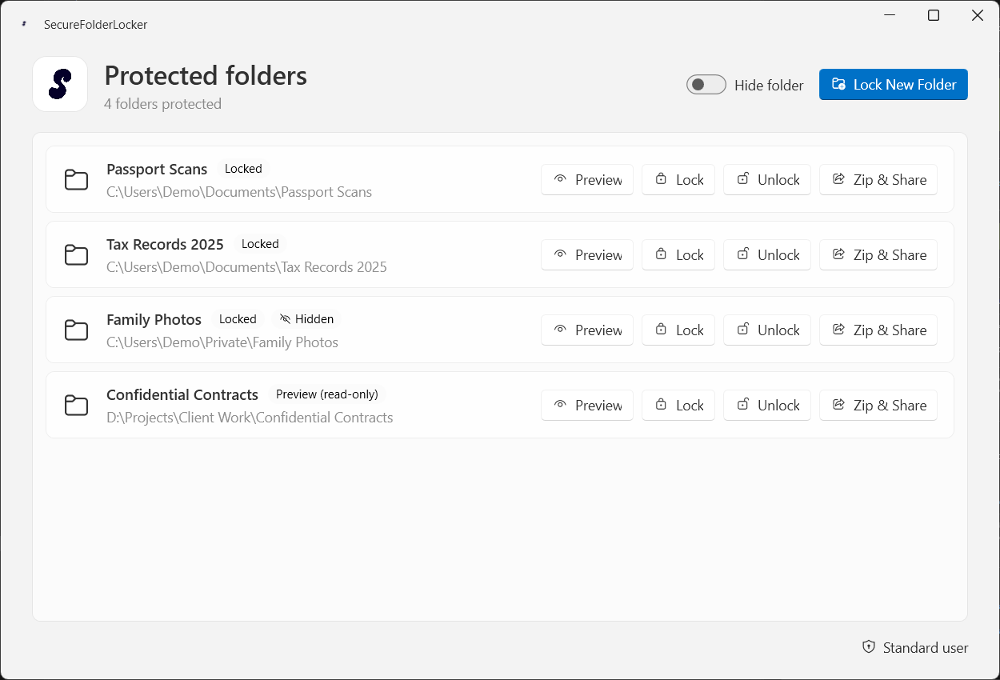

</div>

---

## Features

| | |
|---|---|
| 🔒 **Lock any folder** | Adds an application-owned deny rule to the folder's ACL, so Explorer and other apps cannot open it. Your existing permissions are preserved. |
| 👁️ **Read-only preview** | Enter your master password to open a locked folder read-only. The folder **locks itself again** when you close the Explorer window, when the app closes, or at your next sign-in if a session ended mid-preview. |
| 🫥 **Hide folders** | Optionally mark a locked folder as hidden and system, so it disappears from normal Explorer views. |
| 📦 **Zip & Share** | Export a folder, even a locked one, to a password-protected **AES-256** ZIP with its own password for the recipient. A locked folder is opened read-only only for the export and locked again afterwards. |
| 🛡️ **Starts without UAC** | The app opens like any normal program. It asks to restart as administrator only when you lock, unlock, preview, or export a locked folder. |
| 🔑 **Master password** | Stored only as a BCrypt hash. No plaintext password is saved. |
| ⌨️ **Command line (`sfl`)** | The same features from any terminal, with an arrow-key menu. Extracting a shared ZIP works on any computer, with no setup. See [Command line](#command-line-sfl) and the [CLI guide](docs/CLI.md). |
| 🎨 **Modern Windows 11 UI** | Fluent design with Mica backdrop, native title bar buttons, and automatic light and dark theme. |

## Screenshots

<table>
  <tr>
    <td align="center">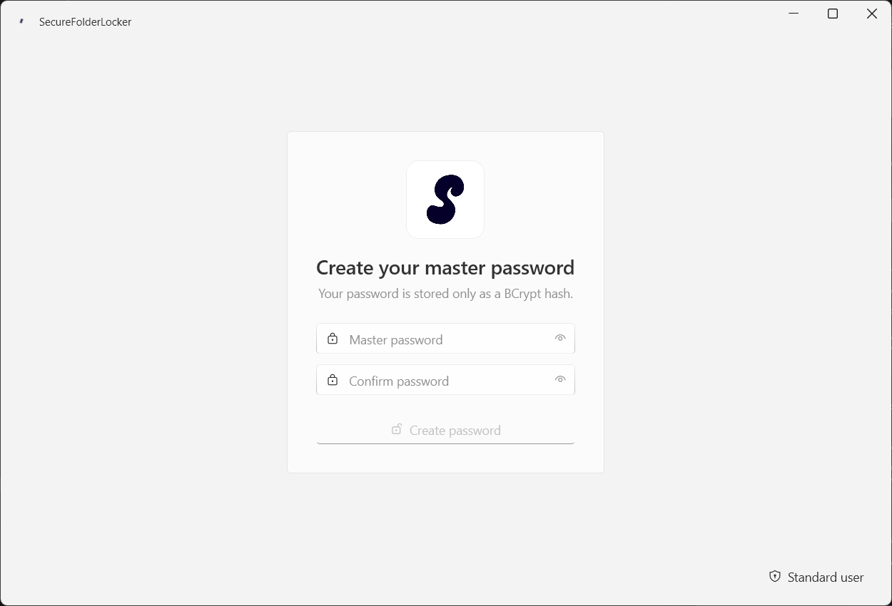<br /><sub><b>First run:</b> create your master password</sub></td>
    <td align="center">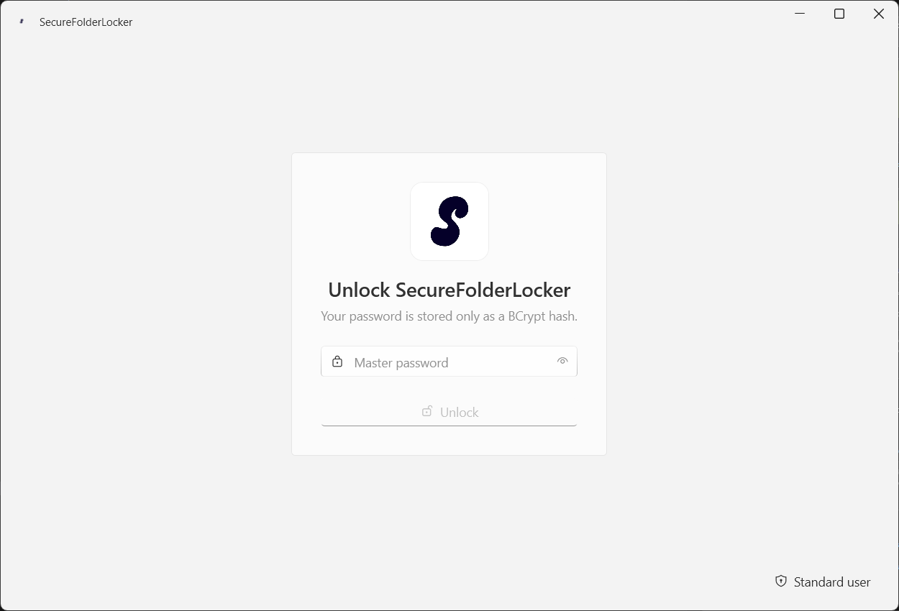<br /><sub><b>Sign in</b> with your master password</sub></td>
  </tr>
  <tr>
    <td align="center">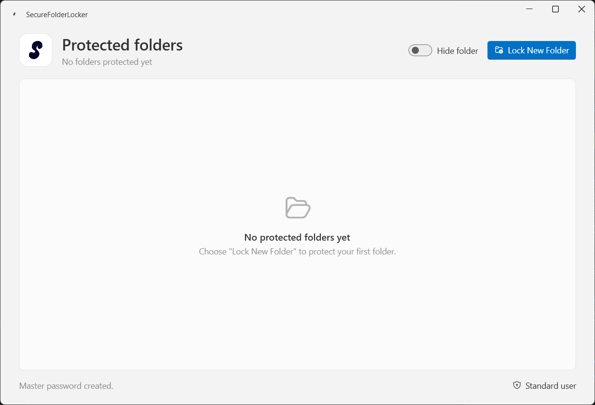<br /><sub><b>Dashboard:</b> nothing locked yet</sub></td>
    <td align="center"><br /><sub><b>Dashboard:</b> locked, hidden, and previewing folders</sub></td>
  </tr>
  <tr>
    <td align="center">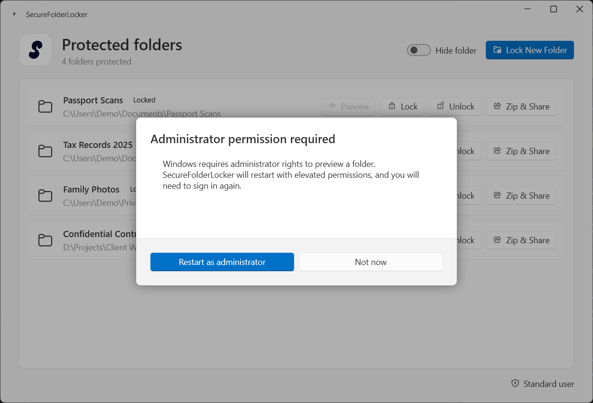<br /><sub><b>On-demand elevation:</b> no UAC at startup</sub></td>
    <td align="center">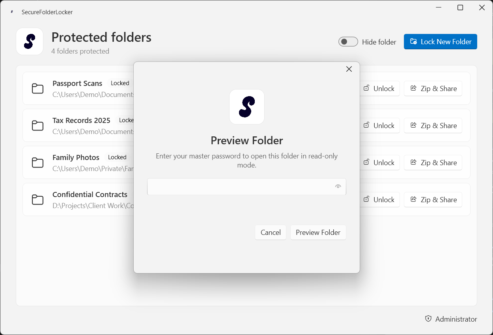<br /><sub><b>Preview:</b> master password required</sub></td>
  </tr>
  <tr>
    <td align="center">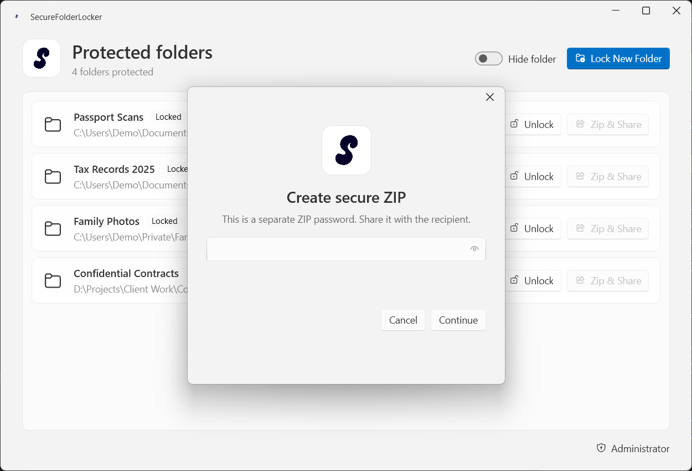<br /><sub><b>Zip &amp; Share:</b> set a separate ZIP password</sub></td>
    <td align="center">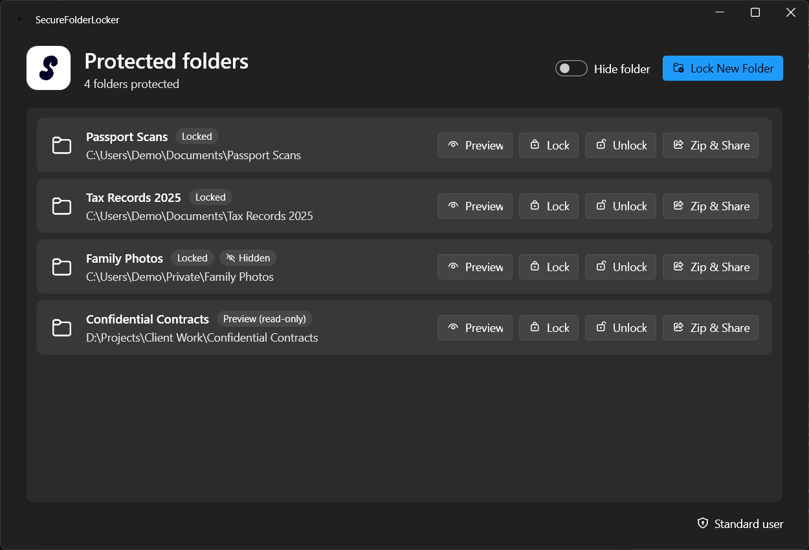<br /><sub><b>Dark theme</b> follows your Windows setting</sub></td>
  </tr>
</table>

## Install

Each [release](../../releases/latest) has two independent installers, so install whichever you need:

| Installer | What it installs |
|---|---|
| `SecureFolderLockerSetup-<version>.exe` | The desktop app, with Start menu and desktop shortcuts. |
| `SfLCliSetup-<version>.exe` | The `sfl` command-line tool, added to your PATH. |

1. Download the installer from the release page.
2. Run it. Both need administrator rights to install under Program Files.
3. Start **Secure Folder Locker** from the Start menu, or open a **new** terminal and run `sfl --help`.

The installers are not code-signed yet, so Windows SmartScreen may show a warning the first time. Both are self-contained and need no separate .NET runtime. Each release also includes a `.sha256` checksum file per installer.

**Requirements:** Windows 10 or 11, 64-bit. An NTFS folder is needed for ACL protection.

## How to use

1. **Create a master password** on first launch. You will need it to sign in and to preview folders.
2. Click **Lock New Folder** and choose a folder. Turn on **Hide folder** first if you also want it hidden. Windows asks for administrator permission the first time, because the app restarts elevated and you sign in again.
3. Use the buttons on each folder:
   - **Preview** opens the folder read-only. It locks again when you close the Explorer window.
   - **Lock** restores the full lock immediately.
   - **Unlock** removes the protection and stops tracking the folder.
   - **Zip & Share** creates an encrypted ZIP you can send to someone.

## Command line (`sfl`)

<div align="center">
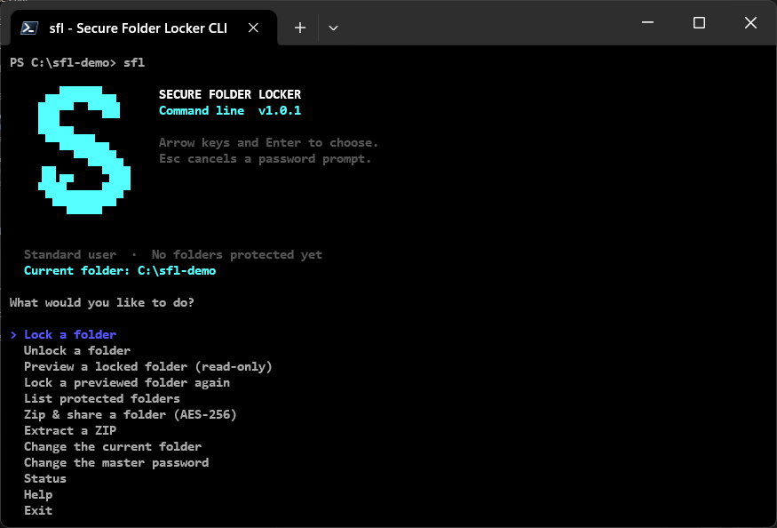
</div>

**`sfl` is the command-line edition of Secure Folder Locker.** It brings everything the desktop app does (locking folders, read-only previews, and AES-256 encrypted ZIP sharing) to any terminal: Command Prompt, PowerShell or Windows Terminal. Use it interactively through an arrow-key menu, or script it with documented exit codes and quiet output.

- **One tool, two ways to work.** Run `sfl` for a guided menu with a folder picker, or run a single command such as `sfl lock C:\Projects\Taxes`.
- **Same vault as the desktop app.** The CLI shares the desktop app's database and master password, so a folder locked in one is visible and manageable in the other.
- **Starts without UAC.** It asks `Restart as administrator? (y/n)` only when a command has to change permissions, then shows the result in your original terminal.
- **Share a ZIP with anyone.** `sfl unzip` extracts an AES-256 ZIP on any computer with only the ZIP password: no master password, no database, no administrator rights.
- **Safe by design.** Passwords are typed at a hidden prompt and never appear on the command line, in shell history or in output. It refuses unsafe paths and archives that try to write outside the destination folder.
- **Self-contained.** A single `sfl.exe` installed by its own installer, which adds it to your PATH. No .NET runtime required.

Install `SfLCliSetup-<version>.exe` from the [latest release](../../releases/latest), open a **new** terminal, and run `sfl --help`. The full guide, with every command, option and exit code, is in **[docs/CLI.md](docs/CLI.md)**.

### Commands

| Command | What it does |
|---|---|
| `sfl` | Open the interactive menu. |
| `sfl init` | Create the master password (first run). |
| `sfl lock <folder> [--hide]` | Lock a folder, optionally hidden from Explorer. |
| `sfl unlock <folder>` | Remove the lock and stop tracking the folder. Asks for the master password. |
| `sfl preview <folder>` | Open a locked folder read-only in Explorer. It locks itself again when the window closes (or on Ctrl+C). |
| `sfl relock <folder>` · `sfl relock --all` | Lock a previewed folder, or every previewed folder, again right away. |
| `sfl list` | Table of protected folders: Locked or Previewing, and Hidden. |
| `sfl zip <folder> [-o file.zip]` | Export a folder, even a locked one, to a password-protected AES-256 ZIP. |
| `sfl unzip <file.zip> [-o folder]` | Extract an AES-256 ZIP. **Needs no setup.** |
| `sfl password change` | Change the master password. |
| `sfl status` · `sfl --help` · `sfl <command> --help` · `sfl --version` | Information. |

Options for every command: `--quiet` (errors and results only), `--no-color` (also honors `NO_COLOR`) and `--yes` (restart as administrator without asking first). There is deliberately **no `--password` option**: a password on the command line ends up in shell history. A line piped to the command is read as the password, so `echo secret | sfl unzip taxes.zip` works in scripts.

### Overview

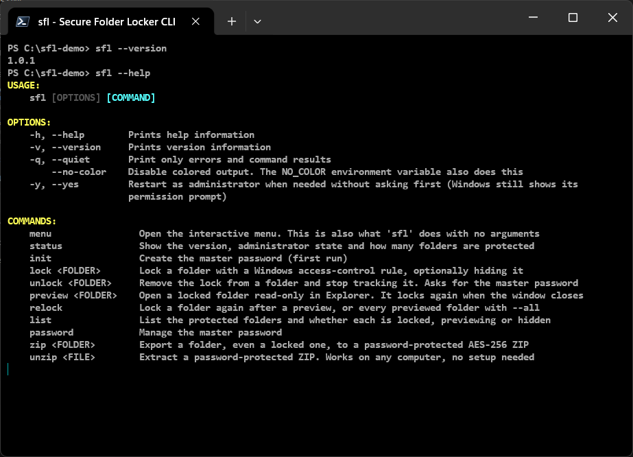

### The interactive menu

Run `sfl` with no arguments. The logo appears once; after that a one-line status shows your access level, how many folders are protected, and the **current folder**. Choosing a folder or a ZIP opens a picker that starts in the current folder: walk into folders with the arrow keys, go up a level, switch drive, or type a path (full or relative).

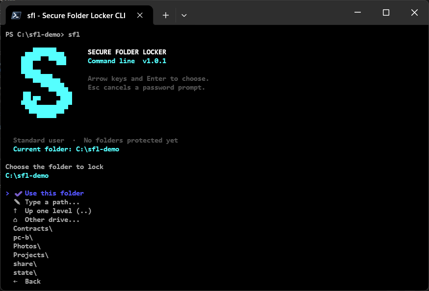

### Create your master password

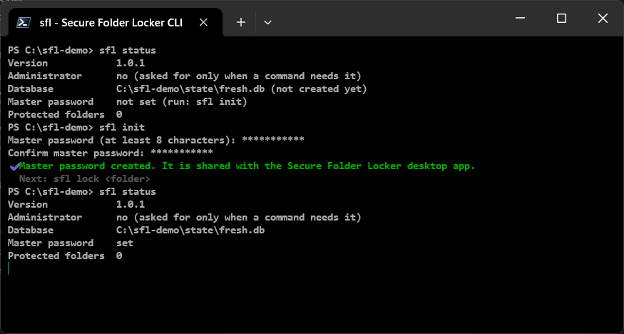

### Lock folders and see what is protected

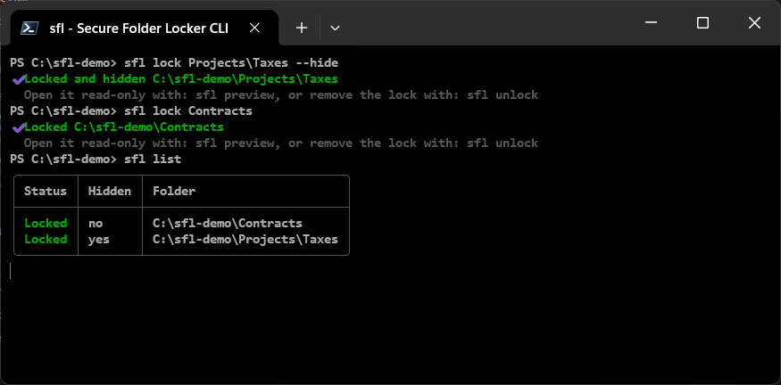

When a command needs administrator rights, `sfl` asks first, restarts itself with the same arguments in an administrator window, and shows that window's result in your terminal. Nothing changes if you answer `n` or dismiss the Windows prompt.

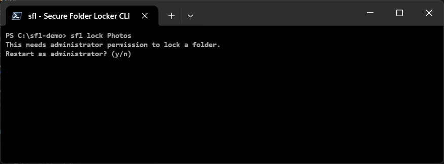

### Preview a locked folder

`sfl preview` asks for the master password, opens the folder read-only in Explorer, and stays running as the watcher. When you close the Explorer window it locks the folder again. If that process is ever killed, `sfl status` and `sfl list` warn about it and `sfl relock --all` recovers.

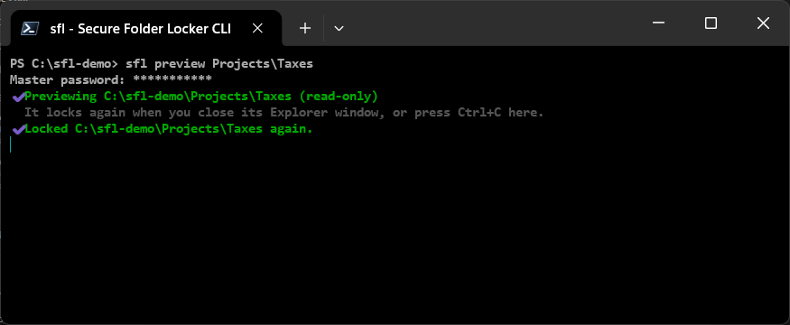

### Zip & share, even a locked folder

`sfl zip` asks for a separate password for the recipient, twice. A locked folder is opened read-only only for the export and locked again afterwards.

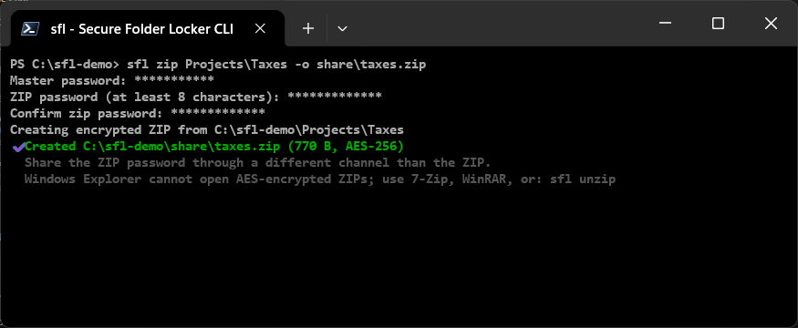

### Extract a ZIP on any computer

On the recipient's computer, install the CLI and run `sfl unzip`. It needs only the ZIP password. A wrong password extracts nothing, and the `status` at the end shows that no database was created on this computer.

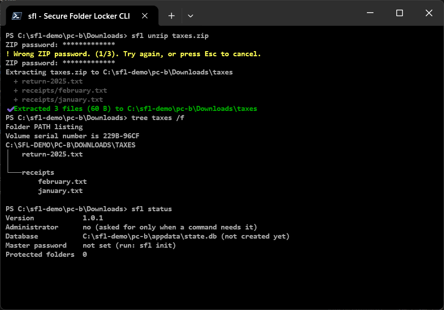

> The screenshots are taken in Windows Terminal. Commands that change folder permissions (`lock`, `unlock`, `preview`, `relock`, and `zip` of a locked folder) are shown as they run in an administrator terminal. See [docs/CLI.md](docs/CLI.md) for the rest: recovery, scripting, safety checks, exit codes and more.

## How it works

- **Locking** adds one deny rule for `Everyone` to the folder's ACL. The rule is identifiable, so the app removes exactly what it added and nothing else.
- **State** (the list of folders, hidden/preview flags, and the password hash) lives in a local SQLite database under `%LOCALAPPDATA%\SecureFolderLocker`. The database is updated only after the file-system change succeeds.
- **Preview** swaps the full-lock rule for a rule that denies writes and deletes but allows reads, then watches the Explorer window.
- **Elevation** is on demand. The app relaunches itself with the `runas` verb when an operation needs administrator rights.

## Security notes

This is a convenience and privacy control, not encryption.

- Folder protection uses Windows ACLs. **A Windows administrator, a bootable external environment, or direct disk access can bypass or change it.** The files themselves are not encrypted.
- Do not rely on it for highly sensitive data. Use disk encryption (BitLocker) or encrypted archives for that.
- The ZIP export **is** encrypted (AES-256), but Windows Explorer cannot open AES-encrypted ZIPs. Recipients need a tool such as 7-Zip or WinRAR. Share the ZIP password through a different channel than the ZIP.
- If you forget the master password, you cannot preview folders. Keep it safe.

See [docs/SECURITY.md](docs/SECURITY.md) for the full threat model.

## Build from source

Requires the [.NET 8 SDK](https://dotnet.microsoft.com/download/dotnet/8.0) on Windows.

```powershell
dotnet restore .\SecureFolderLocker.sln
dotnet build .\SecureFolderLocker.sln --no-restore
dotnet test .\SecureFolderLocker.sln --no-build
dotnet run --project .\SecureFolderLocker.csproj      # desktop app
dotnet run --project .\src\Sfl.Cli -- status          # command-line tool
```

The solution has four projects: the WPF app, the shared `SecureFolderLocker.Core` library, the `sfl` CLI (`src\Sfl.Cli`), and the xUnit tests. Build the installers with [Inno Setup 6](https://jrsoftware.org/isinfo.php); the steps are in [docs/DEPLOYMENT.md](docs/DEPLOYMENT.md).

### Releases

Pushing a version tag runs the tests, builds both installers, and publishes a GitHub Release automatically:

```powershell
git tag v1.1.0
git push origin v1.1.0
```

## Status

The desktop app is implemented and has been checked manually: sign-in, lock, preview auto-lock, ZIP export, and on-demand elevation. The `sfl` command-line tool is implemented and covered by automated xUnit tests (passwords, ACL add/remove, ZIP round trip, wrong password, zip-slip, command parsing, elevation flow, preview). Not yet verified: the administrator-mode (Program Files, system PATH) install of the CLI installer, the real UAC relaunch, and the release workflow on GitHub. See the [roadmap](docs/ROADMAP.md) and [task list](docs/TASKS.md).

## Tech stack

- C# and .NET 8, WPF with [WPF-UI](https://github.com/lepoco/wpfui) (Fluent)
- Shared `SecureFolderLocker.Core` class library used by the app and the CLI
- [Spectre.Console](https://spectreconsole.net/) for the CLI menu, prompts and output
- SQLite via `Microsoft.Data.Sqlite`
- BCrypt via `BCrypt.Net-Next`
- AES-256 ZIP via SharpZipLib
- xUnit tests
- Inno Setup installers and GitHub Actions release pipeline

## Documentation

Start with the [documentation index](docs/README.md). The **[CLI guide](docs/CLI.md)** covers every `sfl` command. The [PRD](docs/PRD.md) defines the product, and [ARCHITECTURE](docs/ARCHITECTURE.md) describes the implementation.

## Contributing

See [CONTRIBUTING.md](CONTRIBUTING.md). Maintainer details are in [CONTRIBUTORS.md](CONTRIBUTORS.md).
