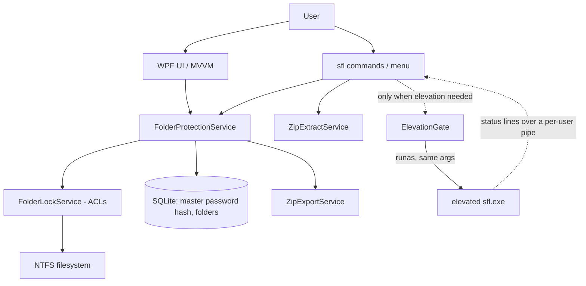

# System Architecture

**Status:** Implemented. The desktop app (WPF, MVVM), the shared `SecureFolderLocker.Core` library, the `sfl` command-line tool, and an xUnit test project exist and build. A manual administrator-mode smoke test and a real UAC relaunch of the CLI are still to be done (see [TASKS](TASKS.md)).

## Boundaries

Two local Windows front ends, the WPF desktop app and the `sfl` command-line tool, share one class library. Both run as the invoking user and ask to restart elevated only when an operation changes folder permissions. Both use one per-user SQLite database and one master password. Windows remains the source of truth for filesystem permissions. No server or cloud boundary exists.

## Technology inventory

| Area | Choice | Status |
| --- | --- | --- |
| Desktop UI | WPF + WPF-UI, MVVM | Implemented |
| Command line | Spectre.Console + Spectre.Console.Cli | Implemented |
| Shared logic | `SecureFolderLocker.Core` (net8.0-windows) | Implemented |
| Runtime | .NET 8 on Windows, self-contained single-file publish | Implemented |
| Persistence | SQLite via Microsoft.Data.Sqlite | Implemented |
| Password hashing | BCrypt.Net-Next | Implemented |
| ZIP | SharpZipLib (AES-256 write and read) | Implemented |
| Tests | xUnit | Implemented |
| Installers | Inno Setup, one per product | Implemented; see [DEPLOYMENT](DEPLOYMENT.md) |

Dependency purposes and licenses (read from each package's metadata): Spectre.Console and Spectre.Console.Cli 0.57.2 (CLI menu, prompts, output, command parsing; MIT); test-only packages Spectre.Console.Testing 0.57.2 (fake console; MIT), Microsoft.NET.Test.Sdk 18.11.0 (MIT), xunit 2.9.3 and xunit.runner.visualstudio 3.1.5 (test framework and runner; Apache-2.0); SharpZipLib 1.4.2 (ZIP; MIT); BCrypt.Net-Next (hashing; MIT); Microsoft.Data.Sqlite 8.0.11 (storage; MIT); WPF-UI 3.0.5 (desktop UI; MIT).

## Modules

```text
SecureFolderLocker.sln
SecureFolderLocker.csproj          WPF app: Presentation/, MainWindow, dialogs, ExplorerPreviewMonitor (DispatcherTimer)
src/SecureFolderLocker.Core/       No UI. Namespaces SecureFolderLocker.Infrastructure and .Models
  DatabaseHelper                   SQLite state and BCrypt master password
  FolderLockService                The only code that reads or writes ACLs
  FolderProtectionService          lock / unlock / preview / relock / export sequences, path validation
  ZipExportService, ZipExtractService
  ElevationService                 Is the process elevated; GUI restart with runas
  ExplorerWindowProbe              Is an Explorer window showing a folder (Shell.Application COM, STA)
  PreviewWatchLease                Exclusive lease file proving a preview watcher is alive
  PasswordPolicy                   Shared minimum length
src/Sfl.Cli/                       sfl.exe
  Hosting/                         CliHost (command tree, error -> exit code), CliContext, ElevationGate, Relay
  Commands/                        One class per command, plus MenuCommand
  Preview/                         PreviewWatcher (rules), IPreviewHost (Explorer, Ctrl+C)
  Ui/                              Output, password and confirm prompts, flows
tests/SecureFolderLocker.Tests/    xUnit
```

The desktop app and the CLI never call the ACL adapter directly from a view or command. Both go through `FolderProtectionService`, which is why they behave identically. Views and commands contain no ACL, database, or ZIP logic.



`unzip` takes the dashed route around the database: `ZipExtractService` has no dependency on `DatabaseHelper`, and `CliContext` creates the database only when a command asks for it, so `sfl unzip` works on a computer that has never run `sfl init` and creates no database file.

## Data flow

**Lock / unlock / preview / relock.** The command validates the path first (`FolderProtectionService.ValidateLockTarget`): it must exist, be on a local NTFS drive, and must not be a drive root, the Windows directory, Program Files, or the folder holding the application's own database (or a parent of it). Only then is administrator permission requested. The ACL is changed by `FolderLockService`, and the database is updated **after** that succeeds. If recording a new lock fails, the lock is removed again so no untracked locked folder is left behind.

**ACL rule.** One deny rule for `Everyone`: `FullControl` for a locked folder, or `Write | Delete | DeleteSubdirectoriesAndFiles` for a preview, inherited by children. Removal matches the exact rule that the application adds (identity, rights, inheritance, propagation) and leaves every other rule alone.

**Hidden flag.** The database records whether the user chose to hide the folder. It stays set during a preview (the attributes are cleared while the folder is readable) so a relock, including recovery after a crash, hides it again. The dashboard shows a "Hidden" badge only while the folder is locked (`LockedFolder.IsCurrentlyHidden`).

**Zip.** `FolderProtectionService.ExportAsync` opens a fully locked folder read-only (preview rule), exports, then locks it again. If the export succeeds but the relock fails it reports that explicitly instead of success.

**Unzip.** `ZipExtractService` validates every entry name before writing anything (no `..` component, no drive or stream (`:`), no leading separator, no component ending in a dot or space, and the resolved path must stay inside the destination). It checks the password before extracting, removes a half-written file if the AES integrity check fails, and removes a destination folder it created if extraction fails.

## Elevation (CLI)

`ElevationGate` returns "continue" when already elevated. Otherwise it asks, relaunches `sfl.exe` with `runas` and the original arguments plus `--sfl-db <database>` and `--sfl-relay <pipe>`, and waits. The elevated copy mirrors each status or error line to the parent through a named pipe restricted to the current user; the parent replays them, and returns the child's exit code. A preview sends `ready` once it is open so the parent can return while the elevated window keeps watching. Details and limits are in [CLI](CLI.md).

## Configuration and secrets

Configuration contains non-secret settings only. Password hashes live in the local database. No secret belongs in source, logs, installer scripts, or documentation. `SFL_DATABASE` selects another database file for the CLI (testing and demos).

## Errors and observability

`FolderProtectionException` carries a typed error (invalid path, unsupported volume, protected location, already locked, not tracked, relock failed). The CLI maps these and the framework exceptions to documented exit codes in one place (`CliHost.MapException`), and the desktop app maps them to status messages. No telemetry. Passwords are never printed or logged.

## Testing and deployment

See [TESTING_STRATEGY](TESTING_STRATEGY.md) and [DEPLOYMENT](DEPLOYMENT.md).

## Trade-offs

ACL protection is lightweight and integrated with Windows, but it is not encryption and cannot defend against all administrators or offline access. This limitation is explicit in the product requirements and in [SECURITY](SECURITY.md).

The namespace `SecureFolderLocker.Infrastructure` was kept for classes moved into `SecureFolderLocker.Core`, so the desktop app's code needed no namespace changes. The WPF project stays at the repository root so existing build paths and installer scripts did not move.
