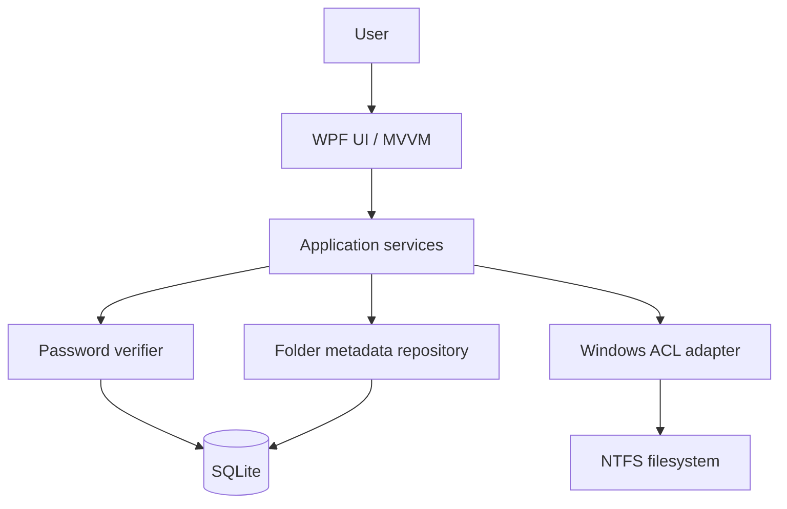

# System Architecture

**Status:** Partial implementation. The .NET 8 WPF shell, as-invoker manifest with on-demand elevation, package references, and ACL adapter are implemented; persistence, MVVM, and full UI remain planned.

## Boundaries

The application is a local WPF process running on Windows. It owns the UI, local SQLite metadata, password verification, and ACL operations. Windows remains the source of truth for filesystem permissions. No server or cloud boundary is planned for the MVP.

## Proposed technology inventory

| Area | Choice | Status |
| --- | --- | --- |
| UI | WPF + WPF-UI | WPF shell implemented; controls planned |
| Runtime | .NET 8 on Windows | Implemented |
| Pattern | MVVM | Planned |
| Persistence | SQLite via Microsoft.Data.Sqlite | Package planned for Step 3 |
| Password hashing | BCrypt.Net-Next | Package planned for Step 3 |
| Installer | Inno Setup | Planned |

## Modules

```text
SecureFolderLocker/
  Presentation/       WPF views, view models, converters
  Application/        use cases and validation
  Domain/             folder protection models and policies
  Infrastructure/     SQLite, BCrypt, Windows ACL adapter
  Tests/              unit and integration tests
```

## Diagram



## Data flow

For lock/unlock, the view model invokes an application command. The command validates the password and canonical path, reads current ACL state, applies/removes the application-owned rule, verifies the resulting state, and then updates SQLite. If the OS operation fails, the database must not claim success.

## Configuration and secrets

Configuration should contain non-secret application settings only. Password hashes and rule metadata are local protected data. No secret value belongs in source, logs, installer scripts, or documentation.

## Errors and observability

Use typed application errors for invalid paths, authorization failures, missing folders, unsupported filesystems, and persistence failures. Show safe user messages and record diagnostic details only in local logs after a privacy review. Telemetry is out of scope for MVP.

## Testing and deployment

Unit-test domain and application services with mocked adapters. Use Windows integration tests for ACL behavior and SQLite persistence. Publish a self-contained or framework-dependent Windows build only after choosing the runtime policy; see [DEPLOYMENT](DEPLOYMENT.md).

## Trade-offs

ACL protection is lightweight and integrated with Windows, but it is not encryption and cannot defend against all administrators or offline access. This limitation is explicit in the product requirements.
