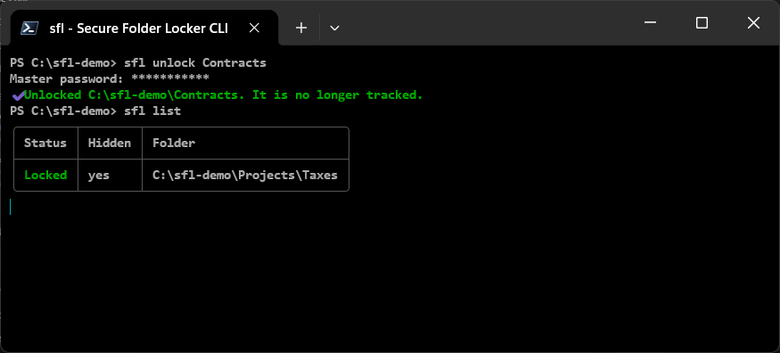
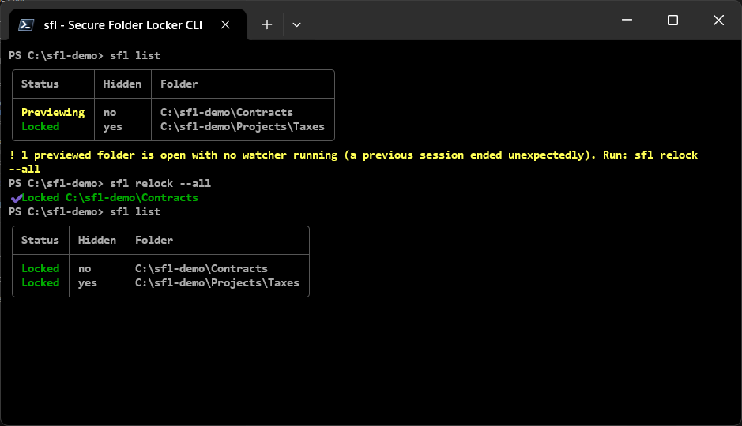
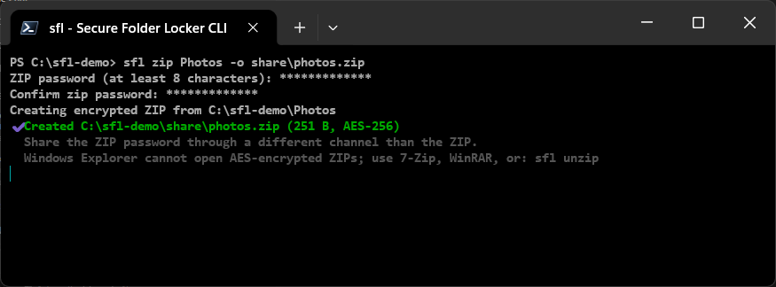
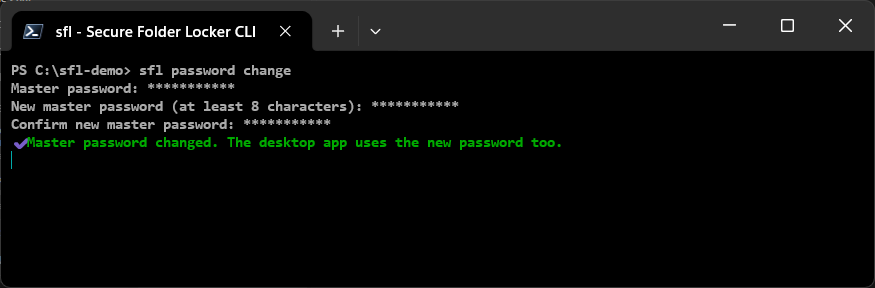
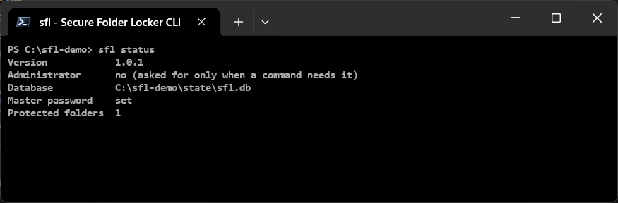
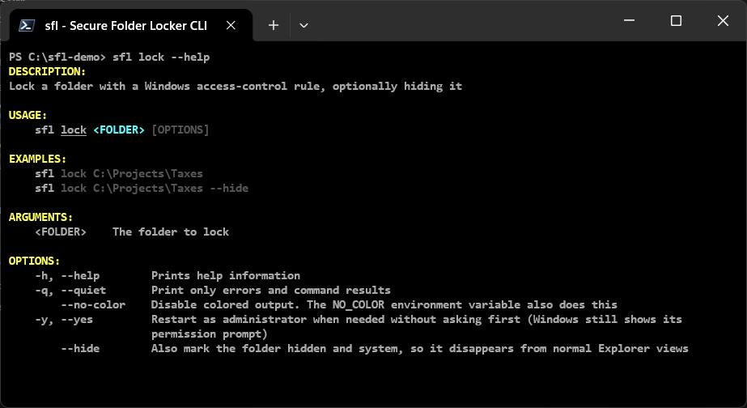
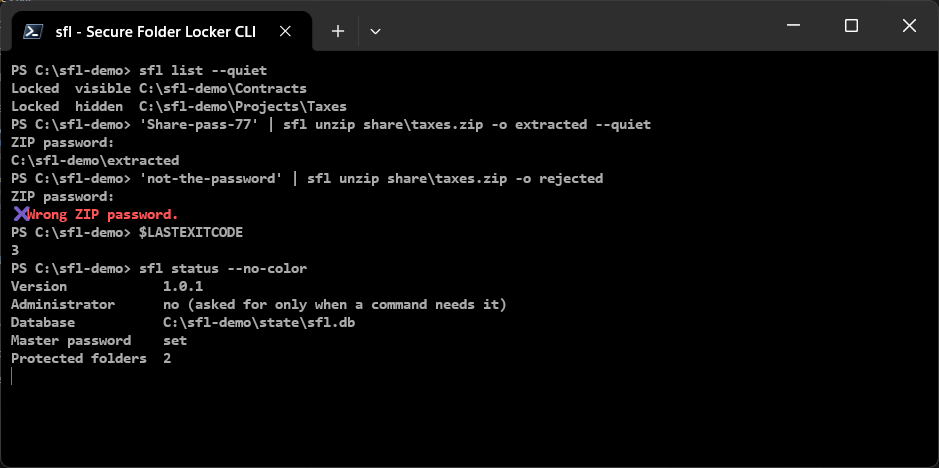
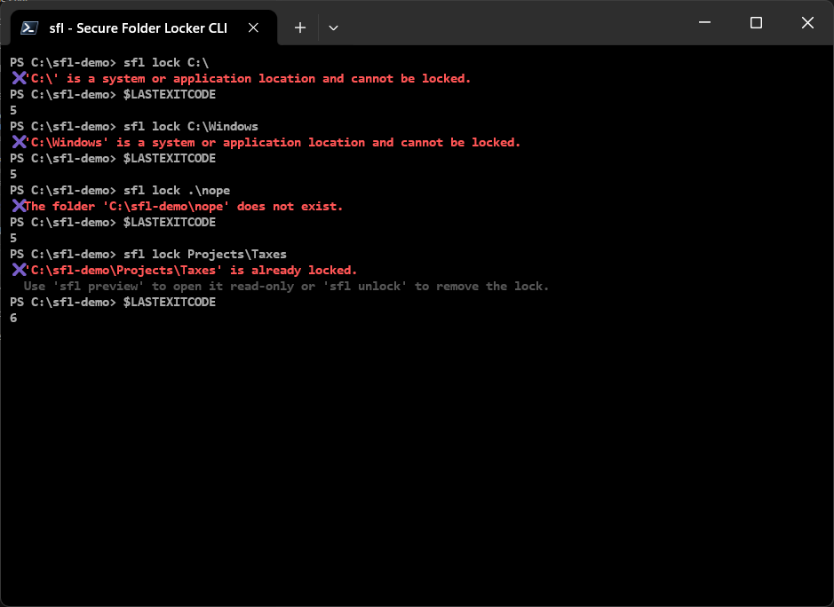

# Secure Folder Locker CLI (`sfl`)

<div align="center">

</div>

**`sfl` is the command-line edition of Secure Folder Locker.** It brings folder locking, read-only previews and AES-256 encrypted ZIP sharing to any Windows terminal: Command Prompt, PowerShell or Windows Terminal. Use it interactively through an arrow-key menu with a built-in folder picker, or drive it from scripts with documented exit codes and quiet output.

It is built for people who live in the terminal, and for sharing: a ZIP made with `sfl zip` can be opened with `sfl unzip` on any computer, with nothing but the ZIP password.

**Status:** implemented and covered by automated tests (see [TESTING_STRATEGY](TESTING_STRATEGY.md)). Items marked *not verified* have not been run on a real machine yet. For the desktop app, see the [root README](../README.md).

## Contents

- [Highlights](#highlights)
- [Install](#install)
- [Quick start](#quick-start)
- [Command reference](#command-reference): [options](#options-for-every-command) · [menu](#sfl-the-interactive-menu) · [init](#sfl-init) · [lock](#sfl-lock) · [unlock](#sfl-unlock) · [preview](#sfl-preview) · [relock](#sfl-relock) · [list](#sfl-list) · [zip](#sfl-zip) · [unzip](#sfl-unzip) · [password change](#sfl-password-change) · [status](#sfl-status) · [help and version](#help-and-version)
- [Administrator permission](#administrator-permission)
- [Preview and recovery](#preview-and-recovery)
- [Scripting and automation](#scripting-and-automation)
- [Safety checks](#safety-checks)
- [Troubleshooting](#troubleshooting)
- [Security](#security) · [Verification status](#verification-status)

## Highlights

| | |
|---|---|
| **Interactive or scripted** | Run `sfl` for a guided menu, or run one command. Both use the same code, so behavior and messages are identical. |
| **Same vault as the desktop app** | The CLI uses the desktop app's database and master password. A folder locked in one appears in the other. |
| **Starts without UAC** | It asks `Restart as administrator? (y/n)` only when a command must change permissions, and shows the result in your original terminal. |
| **Share a ZIP with anyone** | `sfl unzip` needs only the ZIP password: no master password, no database, no administrator rights. |
| **Password-safe** | Passwords go to a hidden prompt. There is no `--password` option, so they never reach shell history, process listings or output. |
| **Careful with paths and archives** | It refuses drive roots, Windows folders and non-NTFS locations, and rejects archives that try to write outside the destination (zip-slip). |
| **Self-contained** | One `sfl.exe`, installed by its own installer and added to PATH. No .NET runtime needed. |

> **What it is not.** Like the desktop app, `sfl` locks folders with Windows access-control rules. That is a convenience and privacy control, **not encryption**: a Windows administrator, a bootable external environment or direct disk access can bypass it. Only the ZIP export is encrypted (AES-256). See [SECURITY](SECURITY.md).

## Install

1. Download `SfLCliSetup-<version>.exe` (and its `.sha256` checksum) from the [latest release](../../../releases/latest).
2. Run it. It installs `sfl.exe` under `C:\Program Files\SecureFolderLockerCLI` and adds that folder to the **system PATH**. It needs administrator rights for that.
3. Open a **new** terminal window (terminals that were already open keep the old PATH) and run:

```powershell
sfl --version
sfl --help
```

Other ways to install:

- **Current user only, no administrator rights:** `SfLCliSetup-<version>.exe /CURRENTUSER` installs to `%LOCALAPPDATA%\Programs\SecureFolderLockerCLI` and adds the folder to your user PATH.
- **Silent:** add `/VERYSILENT /SUPPRESSMSGBOXES /NORESTART`.
- **Uninstall** from *Settings > Apps*. The PATH entry is removed and the rest of PATH is left exactly as it was. Your database is not touched.
- **From source:** `dotnet run --project .\src\Sfl.Cli -- <command>`; see the [root README](../README.md#build-from-source).

The installer is not code-signed yet, so Windows SmartScreen may warn the first time. The first launch after installing takes a few seconds while Windows unpacks and scans the program; later launches take about a quarter of a second.

**Requirements:** Windows 10 or 11, 64-bit. Locking needs an NTFS drive.

## Quick start

```powershell
sfl init                                       # once: choose a master password
sfl lock C:\Projects\Taxes --hide              # lock a folder and hide it from Explorer
sfl list                                       # see what is protected
sfl preview C:\Projects\Taxes                  # open it read-only; it locks itself afterwards
sfl zip C:\Projects\Taxes -o D:\share\taxes.zip   # export to an encrypted ZIP
sfl unlock C:\Projects\Taxes                   # remove the lock when you no longer need it
```

Or just run `sfl` and choose from the menu.


## Command reference

### Options for every command

| Option | Effect |
| --- | --- |
| `-q`, `--quiet` | Print only errors and a command's result. `zip` and `unzip` then print just the output path, and `list` prints one tab-separated line per folder (status, `hidden`/`visible`, path). |
| `--no-color` | Plain text. The `NO_COLOR` environment variable does the same. |
| `-y`, `--yes` | Restart as administrator without asking first. The Windows permission prompt still appears. |
| `-h`, `--help` | Help for `sfl` or for a command: `sfl <command> --help`. |
| `-v`, `--version` | Print the version. |

There is no option to give a password. Passwords are read from the console without echo (shown as `*`), and Esc cancels. When input is redirected, one line is read per prompt (see [Scripting](#scripting-and-automation)).

Which commands need what:

| Command | Master password | Administrator |
| --- | --- | --- |
| `menu`, `list`, `status`, `help` | no | no |
| `init` | creates it | no |
| `lock` | must already exist | yes |
| `unlock` | asks | yes |
| `preview` | asks | yes |
| `relock` | no | yes, unless the folder is already fully locked or nothing is previewed |
| `zip` | only for a fully locked folder | only for a fully locked folder |
| `unzip` | **no** | **no** |
| `password change` | asks (current) | no |

### `sfl` (the interactive menu)

```text
sfl
sfl menu
```

Up/Down (wraps around) and Enter choose an action. The logo is drawn **once** when the menu opens; after that each pass shows one status line (access level, how many folders are protected) and the **current folder**, so the screen does not fill up with banners. With redirected input or output, `sfl` prints the help instead of a menu.

Each action asks for what it needs and then runs the same command you could type, including the administrator restart.

**Choosing a folder or a ZIP** (Lock, Zip & share, Extract a ZIP, Change the current folder) opens a picker that starts in the current folder and shows the path it is in:


- Arrow keys and Enter walk into a sub-folder (`name\`).
- `↑ Up one level (..)` goes to the parent, and `⌂ Other drive...` switches drive.
- `✔ Use this folder` picks the folder you are standing in.
- `✎ Type a path...` lets you type instead: a full path, a path relative to the current folder, `..`, `~` for your user folder, or `%TEMP%`-style variables, with or without quotes.
- When picking a ZIP, the `.zip` files in the folder are listed.
- `← Back` returns to the menu without running anything.

**Change the current folder** moves the menu (and the process, so an administrator restart starts in the same place) to another folder. Relative paths and the default ZIP location follow it. Unlock, Preview and Lock again offer the tracked folders to choose from.

### `sfl init`

Create the master password. Asks twice, at least 8 characters, and fails if one already exists (use [`password change`](#sfl-password-change)). The same password signs in to the desktop app.

```text
sfl init
```


### `sfl lock`

```text
sfl lock <folder> [--hide]
```

Adds the application-owned deny rule to the folder's ACL, then records the folder. Your existing permissions are preserved. `--hide` also marks the folder hidden and system so it disappears from normal Explorer views. The folder must exist, be on a local NTFS drive, and must not be a [protected location](#safety-checks). A folder that is already locked is refused. A master password must already exist.

Needs administrator rights (see [below](#administrator-permission)).


### `sfl unlock`

```text
sfl unlock <folder>
```

Asks for the master password, removes **only** the rule the application added, and stops tracking the folder. Needs administrator rights, which are requested first so that the administrator window is the one that asks for the password.



### `sfl preview`

```text
sfl preview <folder>
```

Asks for the master password, switches the folder to the read-only rule (reads allowed, writes and deletes denied), opens it in Explorer, and **stays running as the watcher**. It locks the folder again when the Explorer window is closed, on Ctrl+C, or when the console window is closed. The terminal you typed the command in is free again as soon as the preview is open. See [Preview and recovery](#preview-and-recovery).


### `sfl relock`

```text
sfl relock <folder>
sfl relock --all
```

Restores the full lock of a previewed folder immediately, or of every previewed folder. A folder that is already fully locked is reported as such and needs no administrator rights. `--all` also recovers a preview whose watcher died.

### `sfl list`

```text
sfl list
```

A table of protected folders: **Locked** or **Previewing**, and whether each is **Hidden**. If a preview has no live watcher (see [recovery](#preview-and-recovery)) it prints a warning with the fix.



### `sfl zip`

```text
sfl zip <folder> [-o file.zip] [--force]
```

Exports a folder to an AES-256 password-protected ZIP. It asks for a **separate ZIP password**, twice (at least 8 characters). Without `-o` the file is `<folder name>.zip` in the current folder; `--force` replaces an existing file. The output must be outside the folder being exported.

- **An ordinary folder** needs no administrator rights and no database:



- **A fully locked folder** is opened read-only only for the export and locked again afterwards. This needs administrator rights and asks for the master password. If the export succeeds but the folder cannot be locked again, it says so instead of reporting success.


Share the ZIP password through a different channel than the ZIP. Windows Explorer cannot open AES-encrypted ZIPs; recipients can use `sfl unzip`, 7-Zip or WinRAR.

### `sfl unzip`

```text
sfl unzip <file.zip> [-o folder] [--force]
```

Extracts an AES-256 ZIP. **It works on any computer**, including one that has never run Secure Folder Locker: it needs only the ZIP password, never opens the database, and needs no administrator rights.

- Without `-o`, files go to a new folder next to the ZIP, named after it (`taxes`, then `taxes (2)`, and so on).
- A non-empty destination is refused unless you pass `--force`; existing files are never overwritten without it.
- At a keyboard you get three attempts at the password; without one, a single attempt.
- A **wrong password extracts nothing** and exits with code 3.
- Archives are checked **before anything is written**. An entry that would land outside the destination (`..`, absolute paths, drive letters, alternate data streams, names Windows would rewrite) rejects the whole archive.


The `status` at the end shows that no database was created on this computer.

### `sfl password change`

```text
sfl password change
```

Asks for the current master password, then a new one twice. The desktop app uses the new password too.



### `sfl status`

```text
sfl status
```

Shows the version, whether the process is administrator, the database path (and whether it exists yet), whether a master password is set, how many folders are protected, and a warning about stale previews.



### Help and version

```text
sfl --help
sfl <command> --help
sfl --version
```



## Administrator permission

`sfl` starts as the invoking user. When a command must change permissions (`lock`, `unlock`, `preview`, `relock`, and `zip` of a locked folder) it:

1. validates everything it can without administrator rights first (the path, NTFS, whether the folder is already locked, that a master password exists);
2. asks `Restart as administrator? (y/n)` (skipped with `--yes`; without a keyboard it stops with exit code 4 and says to use an administrator terminal or `--yes`);
3. starts `sfl.exe` again with the `runas` verb and the **same arguments**;
4. waits, shows the administrator window's result in your original terminal, and returns its exit code.


If you answer `n`, or dismiss the Windows prompt, nothing is changed and the exit code is 4.

The administrator window asks for the passwords itself, so passwords are never sent on a command line. It reports its status and error lines back to the original terminal over a named pipe that only the current user can open; the pipe carries output text only. If the pipe cannot connect, the administrator window stays open until a key is pressed so the result can still be read. The administrator copy is also told which database file the original used, because UAC can run it as a different account whose own profile folder would hold a different, empty database.

## Preview and recovery

`sfl preview` locks the folder again when:

- the Explorer window showing the folder (or one of its sub-folders) is closed;
- Explorer never shows the folder within 20 seconds;
- Ctrl+C is pressed, or the console window is closed (the handler waits for the lock to be restored before Windows ends the process);
- another command (`sfl relock`) already locked it.

While a watcher is alive it holds an exclusive lease file under `%LOCALAPPDATA%\SecureFolderLocker\watchers\`. If the watcher is killed, or the machine loses power, the lease disappears and the folder stays readable until it is locked again. That state is detected:

- `sfl status` and `sfl list` warn about it;
- `sfl relock --all` locks the folder again (shown in the `sfl list` screenshot above);
- the desktop app locks it at its next administrator sign-in. It leaves a preview alone while a watcher still holds the lease.

## Scripting and automation

Everything except password prompts works without interaction.



- **Quiet output.** `--quiet` prints only errors and results: the output path for `zip` and `unzip`, tab-separated lines for `list`.
- **Passwords from a script.** When input is redirected, one line is read per prompt: `echo secret | sfl unzip taxes.zip`. A prompt that gets no line counts as cancelled. There is no password option on purpose.
- **Administrator.** A script cannot answer the y/n question; run it from an administrator terminal, or add `--yes` (Windows still shows its permission prompt, and the passwords are then asked in the administrator window, so locking from an unattended script needs an already elevated terminal).
- **Colors.** `--no-color` or the `NO_COLOR` variable.

### Exit codes

| Code | Meaning |
| --- | --- |
| 0 | Success |
| 1 | An operation failed (I/O, database, ACL, ZIP, unsafe archive) |
| 2 | Usage error: unknown command or option, missing argument |
| 3 | Wrong password, or no master password exists yet |
| 4 | Administrator permission was needed and declined, or could not be obtained |
| 5 | Path problem: missing, invalid, not on a local NTFS drive, or a protected location |
| 6 | State conflict: already locked, not tracked, or output/destination already exists (without `--force`) |
| 130 | Cancelled (Esc, Ctrl+C, or answering no) |

These numbers are tested and are a compatibility promise for scripts.

### Environment

| Variable | Effect |
| --- | --- |
| `SFL_DATABASE` | Use this database file instead of `%LOCALAPPDATA%\SecureFolderLocker\secure-folder-locker.db`. Meant for testing and demos. The desktop app always uses the default location, so the two stop sharing state while this is set. |
| `NO_COLOR` | Disable colors. |

## Safety checks

`sfl` validates a path before it asks for administrator rights or touches any permission, and tells you why it refused:



- A drive root, the Windows directory, Program Files, and the application's own data folder (or any parent of it) cannot be locked: doing so would break Windows or lock the application out of its own state.
- The folder must exist and be on a **local NTFS drive**; network paths and other file systems are refused.
- If recording a new lock fails after the folder was locked, the lock is removed again, so no untracked locked folder is left behind.
- Unlocking removes only the rule the application added, never the rest of the folder's permissions.

## Troubleshooting

| Problem | What to do |
| --- | --- |
| `sfl` is not recognized | Open a **new** terminal after installing; open terminals keep the old PATH. If it still fails, reinstall and check the PATH entry. |
| The first run is slow | Windows unpacks and scans the single-file program once (a few seconds). Later runs are fast. |
| Windows SmartScreen warns about the installer | The installer is not code-signed yet. Verify the `.sha256` checksum from the release page. |
| `sfl preview` says the folder is already open for preview | Another `sfl` window is watching it. Close its Explorer window, or press Ctrl+C there. |
| `sfl list` warns about a preview with no watcher | The watcher was killed. Run `sfl relock --all`. |
| Windows Explorer cannot open the ZIP (error `0x80004005`) | Explorer does not support AES-encrypted ZIPs. Use `sfl unzip`, 7-Zip or WinRAR. |
| `Wrong ZIP password` although the password is right | The password is case-sensitive. A damaged archive reports the same message; ask for the file again. |
| I forgot the master password | It cannot be recovered or bypassed by the tool. Folders stay locked until you remove the rule as a Windows administrator. Keep the password safe. |
| `sfl status` shows a different database than the desktop app | `SFL_DATABASE` is set in this terminal. Clear it. |

## Security

The CLI has the same limits as the desktop app and a few controls of its own: no password option, hidden prompts, a master password for every action that removes or bypasses a lock, validated paths, zip-slip protection, a user-only pipe for the administrator window, and lease-based preview recovery. The full list, including known limits, is in [SECURITY](SECURITY.md#command-line-tool-sfl). The module layout and data flow are in [ARCHITECTURE](ARCHITECTURE.md).

## Verification status

- **Automated tests** cover every command's success and failure paths, exit codes, zip-slip and wrong-password handling, the elevation flow with a fake launcher, the preview rules and the menu with scripted keystrokes.
- **Real machine, observed:** a real Windows Terminal session ran every command shown on this page. The real UAC relaunch was also observed working by the maintainer for `lock` and for `zip` of a locked folder, from the menu (2026-10-17). The per-user installer install and uninstall were run for real.
- **The screenshots** are real Windows Terminal windows running the real commands against a throwaway database and folders. The commands that need administrator rights (`lock`, `unlock`, `preview`, `relock`, `zip` of a locked folder) were run through a build that behaves as an elevated terminal, so the Windows permission prompt itself is not shown; `cli-06-admin-prompt.png` shows `sfl` asking for it.
- **Not yet verified:** `preview` through a real UAC relaunch; the case where UAC asks for a different administrator account's credentials; the administrator-mode (Program Files, system PATH) install; and the release workflow on GitHub. See [TASKS](TASKS.md).
